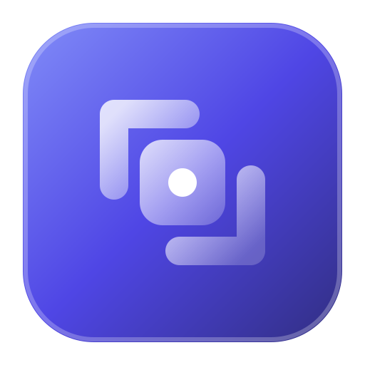
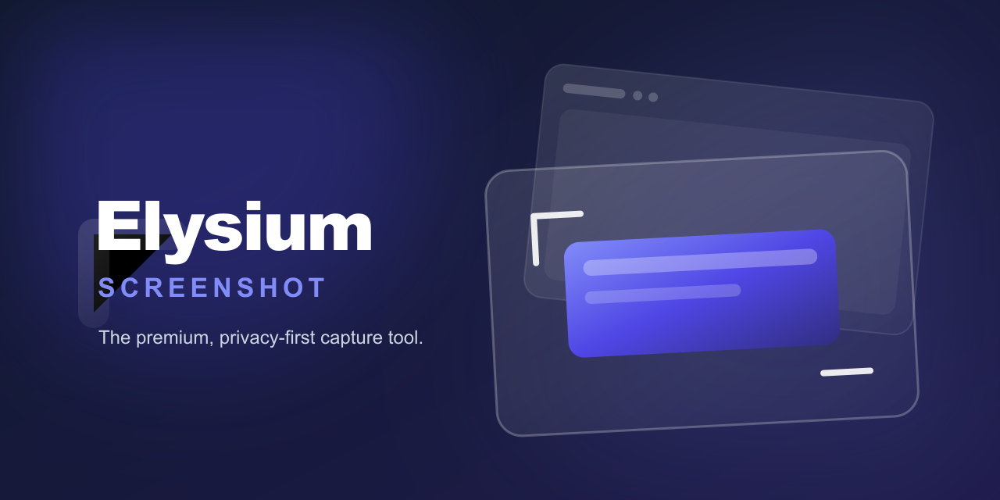

  
  <h1>Elysium Screenshot</h1>
  
<b>The absolute premium, privacy-first capture tool for your browser.</b>

  
  
  
  
  

   
  
  
  
   

  

    Elysium Screenshot is a beautifully designed, high-performance browser extension built to streamline capturing, annotating, and exporting webpages without sacrificing your privacy. Unlike typical screenshot tools, Elysium executes zero cloud processing, running completely securely within your local machine.
  

## ✨ Features

### Capture Modes
- **🖥 Visible Area** — Instantly capture exactly what's on screen.
- **📄 Full Page** — Scroll-and-stitch the entire webpage from top to bottom, even on pages thousands of pixels tall.
- **✂ Region Select** — Click and drag a crosshair to capture any rectangular area.
- **🎯 Element Picker** — Hover over and click any DOM element to capture it with pixel precision.
- **⏱ Delayed Capture** — Set a 3s, 5s, or 10s countdown before capturing, perfect for tooltips and hover states.

### Annotation Editor
- **✏️ Freehand Pen** — Draw directly on your screenshot with adjustable color and line thickness.
- **➡️ Arrows & Lines** — Add directional callouts and dividers.
- **🔲 Shapes** — Overlay rectangles and ellipses with customizable borders.
- **📝 Text Labels** — Place bold annotations with automatic background contrast.
- **🔢 Numbered Markers** — Drop numbered circles for sequential step callouts.
- **🟡 Highlighter** — Semi-transparent brush for emphasizing key areas.
- **🔒 Privacy Blur** — Mosaic-blur sensitive information like emails, passwords, or financials.
- **🧹 Eraser** — Non-destructively erase annotations to reveal the original screenshot beneath.
- **✂ Crop** — Trim the output to any region after annotating.
- **↩️ Undo / Redo** — Full history stack with `Ctrl+Z` / `Ctrl+Y` support.

### Export Options
- **PNG** — Lossless, pixel-perfect quality.
- **JPG** — Adjustable quality slider for smaller file sizes.
- **WebP** — Modern format for the smallest files at great quality.
- **PDF** — Multi-page document export with automatic A4 pagination.
- **📋 Clipboard** — One-click copy to clipboard for instant pasting.

## 🛡️ Privacy

Elysium is built on a **zero-telemetry architecture**:

- 🚫 **No data leaves your browser** — ever. Zero outbound network requests.
- 🚫 **No analytics, tracking, or advertising** — no third-party services of any kind.
- ✅ **100% local processing** — captures, annotations, and exports all happen on your machine.
- ✅ **Open source** — the full codebase is publicly auditable.

See our full [Privacy Policy](PRIVACY_POLICY.md) for details.

## 🚀 Installation

### From GitHub Releases

1. Go to the [Releases page](https://github.com/rps321321/elysium-screenshot/releases).
2. Download the `.zip` for your browser:
   - `elysium-screenshot-1.0.1-chrome.zip`
   - `elysium-screenshot-1.0.1-firefox.zip`
3. Extract the ZIP into a folder.

**Chrome / Edge:**
1. Navigate to `chrome://extensions`
2. Enable **Developer Mode** (toggle in the top-right corner).
3. Click **Load unpacked** and select the extracted folder.

**Firefox:**
1. Navigate to `about:debugging#/runtime/this-firefox`
2. Click **Load Temporary Add-on...**
3. Select the `manifest.json` file inside the extracted folder.

## ⌨️ Keyboard Shortcuts

| Shortcut | Action |
|---|---|
| `Alt+Shift+S` | Capture visible area |
| `Alt+Shift+F` | Capture full page |
| `Alt+Shift+R` | Select region |
| `Alt+Shift+E` | Pick element |
| `Ctrl+Z` | Undo (in editor) |
| `Ctrl+Y` | Redo (in editor) |
| `Ctrl+S` | Open export dialog (in editor) |

> **Tip:** You can customize these shortcuts in your browser at `chrome://extensions/shortcuts`.

## 🛠️ Tech Stack

| Category | Technology | Description |
|----------|------------|-------------|
| **Core** | [WXT](https://wxt.dev/) | Next-generation extension framework with Vite-powered build caching. |
| **View** | [React 19](https://react.dev/) | View layer rendering for the fluid Editor UI. |
| **State** | [Zustand](https://github.com/pmndrs/zustand) | Lightweight, fast, global state-management. |
| **Style** | [Tailwind CSS 4](https://tailwindcss.com/) | Atomic CSS utility layer for the glassmorphic aesthetic. |
| **Logic** | [TypeScript](https://www.typescriptlang.org/) | Strict typings across all background and content scripts. |
| **Storage** | [idb-keyval](https://github.com/nicedoc/idb-keyval) | IndexedDB wrapper for storing high-resolution capture blobs. |
| **PDF** | [jsPDF](https://github.com/parallax/jsPDF) | Client-side PDF generation for document exports. |
| **Tests** | [Vitest](https://vitest.dev/) | Blazing fast unit test runner for core utilities. |

## 📄 License & Rights

Copyright © 2026 Raghvendra Pratap Singh. All Rights Reserved.

This software is provided free of charge for personal and non-commercial use as a browser extension. However, the exact source code distributed in this repository remains under strict proprietary copyright. You may view the source code, but you may not copy, modify, merge, publish, distribute, sublicense, or sell copies of this Software without written permission. See the [LICENSE](LICENSE) file for more information.
